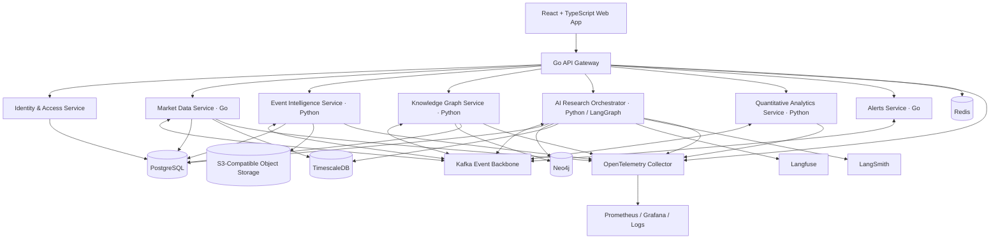
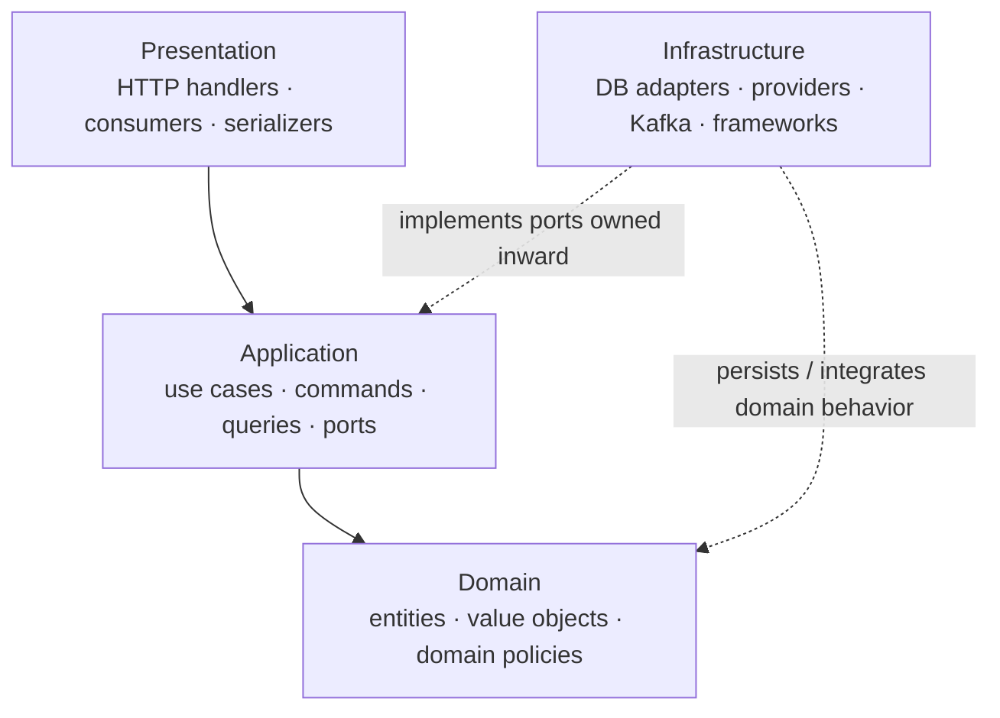
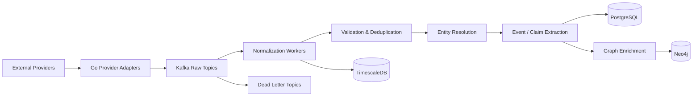
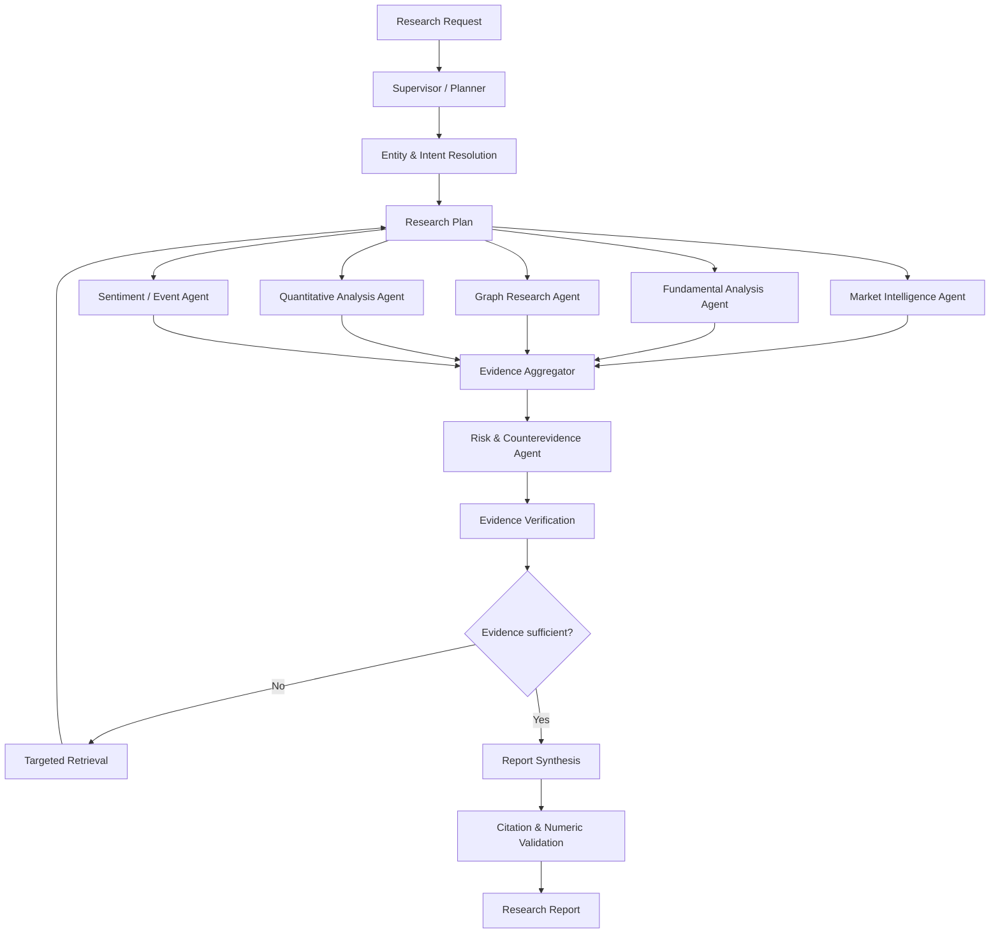

# MarketMind AI

**Agentic Market Intelligence Platform powered by Domain-Driven Microservices, Clean Architecture, Event-Driven Integration, Temporal Knowledge Graphs, and GraphRAG.**

> Portfolio project: an evidence-backed market research platform that connects companies, financial data, corporate events, macroeconomic indicators, and market relationships over time. It uses specialized AI workflows to investigate questions, retrieve supporting evidence, calculate reproducible metrics, and produce explainable research reports.
>
> **Product boundary:** MarketMind is a research and decision-support product. It does not execute trades, provide guaranteed predictions, or represent personalized investment advice.

---

## 1. Product vision

MarketMind is not intended to be another stock-price dashboard or generic financial chatbot. Its differentiator is the ability to investigate how market developments propagate through a network of companies, suppliers, customers, sectors, products, events, and economic indicators.

Example question:

> A major semiconductor manufacturer announces production restrictions. Which publicly traded companies could be affected, through what documented relationships, what historical evidence is relevant, and what scenarios should an analyst investigate?

A research run should:

1. Interpret the question and resolve relevant entities.
2. Retrieve current and historical market evidence.
3. Traverse the temporal company and event knowledge graph.
4. Calculate financial metrics with deterministic code.
5. Compare scenarios and counterevidence.
6. Verify source provenance, dates, calculations, and uncertainty.
7. Produce a cited report and an explorable relationship graph.

### Target users

- Equity and industry researchers
- Market intelligence teams
- Fintech engineers
- Technology and supply-chain analysts
- Individual investors conducting independent research

## 2. Architecture decision

MarketMind uses a **hybrid architecture**:

- **Domain-Driven Design (DDD):** defines bounded contexts, domain language, ownership, and service boundaries.
- **Microservices:** independently deployable services with explicit data ownership.
- **Clean Architecture / Hexagonal Architecture:** organizes code inside each service and keeps business rules independent of frameworks and infrastructure.
- **Event-Driven Architecture (EDA):** Kafka distributes durable domain and integration events between services.
- **CQRS selectively:** separates read models from write models only where query and update needs differ materially.
- **GraphRAG:** combines semantic retrieval with graph traversal and evidence aggregation.
- **LangGraph:** coordinates stateful, multi-step research workflows.

These are complementary dimensions, not competing alternatives. Microservices describe the system boundary; Clean Architecture describes internal dependency direction.

### 2.1 System-level architecture



Kafka is an asynchronous integration backbone, not a mandatory hop for every request. Synchronous HTTP/gRPC is appropriate for bounded request-response operations; Kafka is appropriate for durable asynchronous workflows, fan-out, replay, and decoupling.

### 2.2 Internal service architecture

Each business service follows the same dependency rule, with implementation complexity scaled to the service:



**Dependency rule:** source-code dependencies point inward. Domain code must not import FastAPI, Gin, Kafka clients, Neo4j drivers, SQLAlchemy, LangChain, or LangGraph. Application use cases depend on interfaces/ports; infrastructure provides adapters for those ports.

| Layer | Owns | Must not own |
|---|---|---|
| Presentation | HTTP/gRPC handlers, Kafka consumer entrypoints, request validation, serialization | Business rules or direct database logic |
| Application | Use cases, orchestration, transaction boundaries, ports, DTOs | Framework-specific persistence implementations |
| Domain | Entities, value objects, invariants, domain services, domain events | Network, database, LLM, or framework dependencies |
| Infrastructure | SQL/Neo4j repositories, provider clients, Kafka adapters, observability adapters | Decisions that belong to domain policies |

Not every service needs elaborate domain abstractions. Keep simple services lightweight; apply the full pattern where business rules and change rates justify it.

### 2.3 Domain boundaries and service ownership

| Service / bounded context | Language | Owns | Primary persistence |
|---|---|---|---|
| API Gateway | Go | Routing, request IDs, rate limits, SSE proxying | Redis for ephemeral coordination |
| Identity & Access | Go | Users, organizations, roles, permissions, audit events | PostgreSQL |
| Market Data | Go | Provider adapters, normalized instruments, market observations | PostgreSQL + TimescaleDB |
| Event Intelligence | Python | News/filing normalization, event classification, claims and source provenance | PostgreSQL + object storage |
| Knowledge Graph | Python | Entity resolution, graph facts, relationship validity, graph retrieval | Neo4j + PostgreSQL metadata |
| AI Research Orchestrator | Python | Research runs, LangGraph workflows, agent coordination, report composition | PostgreSQL checkpoints + report records |
| Quantitative Analytics | Python | Reproducible calculations, analytics jobs, benchmark outputs | TimescaleDB + PostgreSQL |
| Alerts & Notifications | Go | Watchlists, alert rules, delivery attempts | PostgreSQL + Kafka |

**Data ownership rule:** a service owns writes to its database/schema. Other services use its API or consume its published events; they do not reach into another service's tables. Neo4j graph writes are owned by the Knowledge Graph service. The orchestrator requests graph operations through the Knowledge Graph API or a documented internal client.

## 3. Technology stack

| Concern | Technology | Rationale |
|---|---|---|
| Frontend | React, TypeScript, Vite | Research terminal and interactive exploration |
| UI state/data | TanStack Query, Zustand | Server-state caching and local UI state |
| Charts | Apache ECharts | Time-series and financial visualizations |
| Graph UI | Cytoscape.js | Interactive relationship exploration |
| API gateway | Go | Efficient routing, auth integration, SSE, rate limiting |
| Domain services | Go + Python | Go for ingestion/operational services; Python for AI and analytics |
| AI orchestration | LangChain + LangGraph | Tool integrations and stateful agent workflows |
| AI observability | Langfuse + LangSmith | Production traces, prompt/cost analytics, debugging and evaluation |
| Graph database | Neo4j | Temporal entity and relationship graph |
| Relational database | PostgreSQL | Transactional metadata, identity, research records |
| Time-series | TimescaleDB extension | Historical market observations and indicators |
| Event backbone | Apache Kafka | Durable asynchronous integration and replay |
| Cache | Redis | Caching, rate limiting, short-lived coordination |
| Object storage | S3-compatible storage | Raw provider payloads and permitted source artifacts |
| Telemetry | OpenTelemetry, Prometheus, Grafana | Distributed traces and infrastructure metrics |
| Deployment | Docker Compose, Kubernetes, Helm | Local development and production deployment |
| CI | GitHub Actions | Build, test, scan, publish and deploy |

Use provider adapters and avoid coupling the domain model to one market-data vendor. Confirm provider coverage, licensing, exchange attribution, redistribution, historical access, and rate limits before production use.

## 4. Data sources and ingestion

Initial integrations:

| Data | Candidate source | Usage |
|---|---|---|
| Regulatory filings and company facts | SEC EDGAR APIs | Submissions, filings, XBRL facts |
| Economic indicators | FRED API | Rates, inflation, macroeconomic series |
| Market prices and fundamentals | Licensed market-data provider | OHLCV, corporate actions, fundamentals |
| News | Licensed news API | Headlines, publication metadata, event discovery |
| Company identifiers | SEC CIK/ticker mappings and provider identifiers | Entity resolution |

Official references:
- [SEC EDGAR API documentation](https://www.sec.gov/edgar/sec-api-documentation)
- [FRED API documentation](https://fred.stlouisfed.org/docs/api/fred/)
- [LangGraph documentation](https://docs.langchain.com/oss/python/langgraph/overview)
- [Langfuse documentation](https://langfuse.com/docs)
- [LangSmith documentation](https://docs.langchain.com/langsmith/home)
- [Neo4j GraphRAG for Python](https://neo4j.com/docs/neo4j-graphrag-python/current/)

### 4.1 Ingestion flow



Required ingestion properties:

- Idempotency keys and provider event identifiers
- Schema versioning and backward-compatible event evolution
- Retry with exponential backoff and bounded attempts
- Dead-letter topics and replay tooling
- Outbox pattern for reliable database-to-Kafka publication
- Raw payload retention according to provider license and policy
- Data quality checks, freshness indicators, and provenance
- Explicit distinction between event time, publication time, and ingestion time

### 4.2 Kafka topic convention

| Topic | Meaning |
|---|---|
| `market.prices.raw.v1` | Provider price observations |
| `market.fundamentals.raw.v1` | Provider financial facts |
| `market.filings.raw.v1` | Filing notifications |
| `market.news.raw.v1` | News metadata and permitted content |
| `market.events.normalized.v1` | Normalized market events |
| `market.entities.resolved.v1` | Entity resolution outcomes |
| `market.graph.updated.v1` | Graph change notifications |
| `market.research.requested.v1` | Research jobs |
| `market.research.completed.v1` | Completed research results |
| `market.alerts.generated.v1` | Alert candidates |
| `market.ingestion.dlq.v1` | Failed records for inspection/replay |

Example event envelope:

```json
{
  "event_id": "uuid",
  "event_type": "market.filings.published",
  "schema_version": 1,
  "occurred_at": "2026-10-31T09:00:00Z",
  "published_at": "2026-10-31T09:01:00Z",
  "ingested_at": "2026-10-31T09:01:03Z",
  "source": {
    "provider": "sec_edgar",
    "external_id": "accession-number"
  },
  "entity_refs": [
    {"type": "company", "id": "cik:0000000000"}
  ],
  "payload": {}
}
```

## 5. Data architecture and schemas

### 5.1 PostgreSQL ownership

Suggested initial logical schemas (or service-owned databases as deployment evolves):

- `identity`: organizations, users, roles, permissions, audit events
- `market`: companies, instruments, provider identifiers, source registry
- `events`: normalized events, claims, source metadata
- `research`: research sessions, workflow status, reports, evidence references
- `alerts`: watchlists, alert rules, notification attempts

Core entities:

```text
organizations(
  id UUID PK,
  name,
  created_at
)

users(
  id UUID PK,
  organization_id UUID FK,
  email UNIQUE,
  status,
  created_at
)

companies(
  id UUID PK,
  canonical_name,
  country,
  created_at
)

company_identifiers(
  id UUID PK,
  company_id UUID FK,
  scheme,             -- CIK, LEI, provider ID, etc.
  identifier,
  valid_from,
  valid_to,
  UNIQUE(scheme, identifier, valid_from)
)

instruments(
  id UUID PK,
  company_id UUID FK,
  ticker,
  exchange,
  currency,
  valid_from,
  valid_to
)

data_sources(
  id UUID PK,
  provider,
  external_id,
  canonical_url,
  published_at,
  retrieved_at,
  license_classification,
  content_hash
)

market_events(
  id UUID PK,
  event_type,
  title,
  summary,
  occurred_at,
  published_at,
  source_id UUID FK,
  status
)

claims(
  id UUID PK,
  subject_ref,
  predicate,
  object_ref,
  confidence,
  evidence_type,
  valid_from,
  valid_to,
  observed_at,
  source_id UUID FK
)

research_sessions(
  id UUID PK,
  organization_id UUID FK,
  user_id UUID FK,
  question,
  status,
  thread_id,
  created_at,
  completed_at
)

research_reports(
  id UUID PK,
  session_id UUID FK,
  schema_version,
  report JSONB,
  generated_at
)
```

These are logical schema sketches, not a complete migration. Add foreign keys, indexes, check constraints, tenant policies, retention policies, and audit fields as implementation proceeds.

### 5.2 TimescaleDB

Store market observations separately from transactional records. Example:

```sql
CREATE TABLE market_prices (
    time        TIMESTAMPTZ NOT NULL,
    instrument_id UUID NOT NULL,
    provider    TEXT NOT NULL,
    open        NUMERIC(20, 8),
    high        NUMERIC(20, 8),
    low         NUMERIC(20, 8),
    close       NUMERIC(20, 8),
    volume      BIGINT,
    currency    TEXT NOT NULL,
    is_delayed  BOOLEAN NOT NULL DEFAULT TRUE,
    PRIMARY KEY (time, instrument_id, provider)
);

SELECT create_hypertable(
    'market_prices',
    by_range('time'),
    if_not_exists => TRUE
);
```

Model corporate actions, adjusted/unadjusted prices, exchange calendars, missing observations, currencies, and provider corrections explicitly. Do not silently mix price series with different adjustment semantics.

### 5.3 Temporal knowledge graph

Core node labels:

- `Company`
- `Instrument`
- `Sector`
- `Industry`
- `Product`
- `Executive`
- `Institution`
- `MarketEvent`
- `EconomicIndicator`
- `NewsItem`
- `Claim`
- `Source`

Core relationships:

- `ISSUED`
- `BELONGS_TO`
- `OPERATES_IN`
- `SUPPLIES`
- `CUSTOMER_OF`
- `COMPETES_WITH`
- `PRODUCES`
- `AFFECTED_BY`
- `REPORTED_IN`
- `IMPACTS`
- `SUPPORTED_BY`
- `ABOUT`

Represent uncertain or sourced assertions as claims rather than unquestionable facts. Every material relationship should preserve:

- `valid_from` / `valid_to`: when the fact was true in the world
- `observed_at`: when MarketMind learned the fact
- `source_id`: provenance reference
- `confidence`: extraction/assessment confidence, not truth probability unless calibrated
- `evidence_type`: reported fact, calculated metric, or inference
- `status`: active, disputed, superseded, or unverified

This enables historical “as-of” queries and prevents current relationships from being incorrectly applied to historical events.

## 6. GraphRAG design

Use the maintained [Neo4j GraphRAG Python package](https://neo4j.com/docs/neo4j-graphrag-python/current/) (`neo4j-graphrag`) as a starting point. Do not start new development on the deprecated `neo4j-genai` package.

Retrieval plan:

1. Resolve named companies, tickers, sectors, and events.
2. Retrieve relevant source-backed claims and event records.
3. Run hybrid vector/full-text retrieval for semantic and exact matches.
4. Expand selected graph entities through bounded, typed, time-aware traversal.
5. Retrieve numerical evidence from the quantitative service.
6. Deduplicate and rank evidence by relevance, source quality, freshness, and temporal validity.
7. Return evidence IDs and graph paths to the orchestrator.
8. Generate an answer constrained to retrieved evidence.
9. Verify claims and citations before publication.

Retrieval modes:

| Mode | Purpose |
|---|---|
| Vector | Semantic similarity over event/source text |
| Full-text | Exact company, ticker, product, and filing terms |
| Hybrid | Combine semantic and lexical matching |
| Vector + Cypher | Enrich vector matches with graph neighbors |
| Entity traversal | Follow typed relationships with depth limits |
| Temporal traversal | Restrict facts to an as-of date |
| Community/sector retrieval | Summarize connected entities and shared exposures |

Never allow an LLM-generated Cypher query to execute without validation, read-only credentials, query timeouts, tenant scoping, depth limits, and result limits. Prefer parameterized, reviewed query templates for core product workflows.

## 7. AI research orchestration

### 7.1 LangChain and LangGraph responsibilities

- **LangChain:** model/provider adapters, structured output, reusable tools, prompt templates, and integrations.
- **LangGraph:** stateful workflow, routing, parallel branches, retries, checkpointing, and human review gates.
- **Domain/application layer:** owns research use cases and contracts; it must not be coupled to framework-specific objects.
- **Infrastructure adapters:** implement model, graph, market-data, persistence, and telemetry ports.

### 7.2 Research workflow



### 7.3 Agents

| Agent | Responsibility | Tools |
|---|---|---|
| Supervisor | Understand request, plan and route work | Entity resolution, planning |
| Market Intelligence | Find recent events and developments | Event search, filing search, news search |
| Fundamental Analysis | Analyze statements and reported metrics | Company facts, financial statements |
| Graph Research | Discover multi-hop company/event relationships | Graph traversal, GraphRAG |
| Quantitative Analysis | Compute returns, volatility, correlation, event windows | Deterministic analytics API |
| Sentiment/Event | Classify narratives and event direction with evidence | Event classification, source retrieval |
| Risk & Counterevidence | Identify alternative explanations and uncertainty | Evidence search, scenario tools |
| Verification | Check provenance, dates, arithmetic, and support | Source lookup, calculation replay, citation validation |

Agents return typed, bounded results. They do not independently invent facts or make unreviewed financial calculations.

### 7.4 Shared state contract

```python
from typing import TypedDict

class ResearchState(TypedDict):
    research_id: str
    question: str
    as_of: str | None
    entities: list[dict]
    research_plan: dict
    market_evidence: list[dict]
    fundamental_evidence: list[dict]
    graph_evidence: list[dict]
    quantitative_evidence: list[dict]
    event_evidence: list[dict]
    risk_assessment: dict
    verification_result: dict
    citations: list[dict]
    report: dict
    retry_count: int
    status: str
```

Define reducers for concurrent state updates and keep state payloads compact: store evidence IDs and references instead of copying large source documents into every checkpoint.

Use a persistent LangGraph checkpointer for thread/run recovery. Separate workflow checkpoint state from long-term product records and graph knowledge. Add workflow versioning, idempotent tool calls, timeouts, bounded retries, cancellation, and explicit terminal states.

### 7.5 Evidence contract

```python
from pydantic import BaseModel
from typing import Literal

class Evidence(BaseModel):
    evidence_id: str
    source_id: str
    claim: str
    entity_ids: list[str]
    published_at: str | None
    observed_at: str | None
    evidence_type: Literal[
        "reported_fact",
        "calculated_metric",
        "inference"
    ]
    confidence: float | None

class ImpactAssessment(BaseModel):
    affected_entities: list[str]
    impact_type: Literal["positive", "negative", "mixed", "unknown"]
    rationale: str
    evidence: list[Evidence]
    assumptions: list[str]
    uncertainties: list[str]
```

Distinguish model confidence from calibrated statistical probability. Every report conclusion should be traceable to evidence, calculations, assumptions, or explicitly labeled inference.

## 8. Langfuse, LangSmith, and OpenTelemetry

Use these tools for complementary purposes rather than duplicating every signal without a reason.

| Tool | Primary responsibility |
|---|---|
| Langfuse | LLM traces, prompt/version management, token and cost analytics, production feedback |
| LangSmith | LangGraph execution debugging, datasets, experiments, agent evaluation |
| OpenTelemetry | Vendor-neutral traces, metrics, and context propagation across services |
| Prometheus/Grafana | Infrastructure and service-level dashboards |

Propagate correlation identifiers:

```text
request_id
organization_id
research_id
langgraph_thread_id
trace_id
langfuse_trace_id
langsmith_run_id
```

Redact secrets and sensitive user data. Apply retention, sampling, access control, and tenant policies. Do not send entire licensed provider payloads to observability tools unless permitted.

## 9. API design

Base path: `/api/v1`

| Method | Endpoint | Purpose |
|---|---|---|
| POST | `/auth/login` | Authenticate |
| GET | `/companies` | Search companies |
| GET | `/companies/{id}` | Company profile |
| GET | `/companies/{id}/relationships` | Bounded graph view |
| GET | `/stocks/{ticker}/prices` | Historical prices |
| GET | `/market/events` | Search events |
| POST | `/research` | Create research run |
| GET | `/research/{id}` | Research status/report |
| GET | `/research/{id}/stream` | SSE progress stream |
| GET | `/research/{id}/graph` | Research-specific graph |
| POST | `/watchlists` | Create watchlist |
| GET | `/watchlists` | List watchlists |
| POST | `/alerts` | Create alert |
| GET | `/analytics/correlation` | Correlation analysis |
| GET | `/analytics/volatility` | Volatility analysis |

Example request:

```json
{
  "question": "Analyze semiconductor supply-chain risks",
  "scope": {
    "tickers": ["NVDA", "AMD", "TSM"],
    "sectors": ["Technology"],
    "time_horizon": "6_months"
  },
  "research_depth": "comprehensive",
  "include_graph": true,
  "include_quantitative_analysis": true
}
```

Return `202 Accepted` with a `research_id` for asynchronous work. SSE events should expose concise status updates, not private chain-of-thought:

```text
event: research.started
data: {"research_id":"res_123"}

event: agent.started
data: {"agent":"graph_research"}

event: evidence.discovered
data: {"count":12}

event: agent.completed
data: {"agent":"graph_research"}

event: verification.completed
data: {"status":"passed"}

event: research.completed
data: {"report_id":"report_123"}
```

Use pagination, request validation, tenant authorization, timeouts, idempotency keys, and bounded graph traversal.

## 10. Frontend

Primary pages:

- Market Overview
- Company Explorer
- Graph Explorer
- AI Research Workspace
- Research Reports
- Event Intelligence
- Quantitative Analytics
- Watchlists
- Alerts
- AI Quality / Operations

Research workspace layout:

1. Research conversation and question controls
2. Agent execution timeline with concise status summaries
3. Evidence panel with source and publication timestamps
4. Interactive graph panel
5. Report panel with citations, assumptions, and uncertainty

Do not expose internal chain-of-thought. Display user-safe execution summaries, tool activity, evidence, and workflow status.

## 11. Security, reliability, and product constraints

- OIDC/OAuth2 authentication and tenant-scoped RBAC
- Service-to-service authentication
- Secrets manager; no secrets in source control
- Read-only graph credentials for retrieval
- Parameterized and allowlisted graph queries
- Prompt-injection defenses for untrusted news and filings
- Tool allowlists, bounded execution, and human approval for sensitive actions
- Kafka retries, DLQs, idempotent consumers, and replay procedures
- Database backups, restore drills, migrations, and retention policies
- Audit events for sensitive operations
- Provider licensing and redistribution compliance
- Data freshness and delayed-data labels
- No autonomous trade execution

## 12. Testing and evaluation

### Conventional software testing

| Layer | Tools | Focus |
|---|---|---|
| Python unit | pytest | Domain rules, adapters, calculations, agent tools |
| Go unit | `go test`, testify | Handlers, domain rules, consumers |
| Contract | OpenAPI/schema tests | Service and event compatibility |
| Integration | Testcontainers | PostgreSQL, Kafka, Neo4j |
| Frontend | Vitest, Testing Library | UI behavior |
| E2E | Playwright | Full research journey |
| Load | k6 | API, SSE, ingestion and concurrency |
| Security | SAST, dependency scanning, container scanning | Supply-chain and application security |

### AI evaluation

Build a manually reviewed dataset of research questions with expected entities, relationships, sources, dates, calculations, and answer requirements.

Measure:

- Entity extraction precision/recall/F1
- Relationship extraction precision/recall/F1
- Retrieval Recall@K and MRR
- Evidence coverage and citation precision
- Temporal validity of graph paths
- Numerical agreement with deterministic fixtures
- Unsupported-claim rate
- Workflow completion and recovery rate
- Latency and cost per research run

### Required ablation study

Compare:

1. Vector RAG
2. Hybrid vector + full-text RAG
3. Graph-enhanced retrieval
4. Full multi-agent GraphRAG

Report quality, retrieval recall, evidence coverage, latency, and cost. Do not claim GraphRAG is better without measured results on the project's benchmark.

### Failure-injection cases

- Market data provider timeout
- Duplicate Kafka event
- Out-of-order event
- Neo4j unavailable
- LLM rate limit or timeout
- Worker restart during a graph run
- Missing or contradictory sources
- Historical relationship invalid at event time
- Tenant boundary violation
- Incorrect currency or adjusted-price series

## 13. Development roadmap

Target: 12 weeks for a focused portfolio MVP and advanced release. Adjust scope based on provider access, data licensing, and available development time.

### Phase 1 — Architecture and platform foundation (Weeks 1–2)

**Milestones**
- M1.1: Monorepo, service templates, linting, CI skeleton
- M1.2: Go gateway, identity, OIDC/RBAC foundation
- M1.3: Docker Compose for PostgreSQL, Neo4j, Kafka, Redis
- M1.4: OpenAPI, event envelopes, ADRs, service ownership

**Acceptance criteria**
- Services start locally with health checks.
- API gateway routes to one sample service.
- Event schema is versioned and validated.
- No service directly accesses another service's database.

### Phase 2 — Market data and ingestion (Weeks 3–4)

**Milestones**
- M2.1: Provider adapter interface and SEC integration
- M2.2: FRED integration and market-price provider adapter
- M2.3: Kafka topics, normalization, idempotency, DLQ
- M2.4: PostgreSQL/Timescale persistence and data-quality checks

**Acceptance criteria**
- At least one company and one economic/market data pipeline works end to end.
- Replaying the same source event does not create duplicates.
- Provider timestamps and freshness are preserved.
- Data source and license metadata are recorded.

### Phase 3 — Knowledge graph and GraphRAG (Weeks 5–6)

**Milestones**
- M3.1: Company identity and graph schema
- M3.2: Source-backed claim and relationship ingestion
- M3.3: Temporal validity and entity resolution
- M3.4: Hybrid retrieval and bounded graph expansion

**Acceptance criteria**
- Graph entities have stable canonical identifiers.
- Material edges have provenance and temporal fields.
- A multi-hop query returns paths with source references.
- Historical queries exclude relationships outside their valid interval.

### Phase 4 — Agentic research engine (Weeks 7–8)

**Milestones**
- M4.1: LangChain model/tool adapters and typed contracts
- M4.2: LangGraph supervisor and persistent checkpointing
- M4.3: Market, Graph, and Quant agents
- M4.4: Evidence verification, report synthesis, cancellation/retry

**Acceptance criteria**
- A research question completes an end-to-end workflow.
- Workflow can resume after worker interruption.
- Numerical calculations come from deterministic tools.
- Every material report claim is linked to evidence or labeled inference.

### Phase 5 — Observability and evaluation (Weeks 9–10)

**Milestones**
- M5.1: Langfuse tracing and prompt/version tracking
- M5.2: LangSmith tracing, datasets, and experiments
- M5.3: Evaluation dataset and custom evaluators
- M5.4: GraphRAG ablation, regression suite, cost/latency dashboard

**Acceptance criteria**
- A research run can be correlated across services and AI traces.
- Evaluation results are reproducible and versioned.
- Vector-only and graph-enhanced retrieval are compared.
- Sensitive values are redacted from traces.

### Phase 6 — Product UI and deployment (Weeks 11–12)

**Milestones**
- M6.1: Market overview and company explorer
- M6.2: Research workspace with SSE progress
- M6.3: Evidence panel and graph explorer
- M6.4: E2E, security, deployment, demo and documentation

**Acceptance criteria**
- User can submit a research question and receive a report.
- User can inspect sources and graph paths.
- E2E test covers the principal journey.
- Docker Compose quickstart and deployment guide are verified.
- Demo data is clearly labeled and no real trading is performed.

### Suggested milestone order

Build one vertical slice early: one company → one filing/event → one graph claim → one GraphRAG query → one LangGraph research run → one cited UI report. Then expand providers, agents, and breadth. This reduces the risk of building many disconnected services before proving product value.

## 14. Repository structure

```text
marketmind-ai/
├── services/
│   ├── api-gateway/                 # Go
│   ├── identity-service/             # Go
│   ├── market-data-service/          # Go
│   ├── event-intelligence/           # Python
│   ├── knowledge-graph-service/      # Python
│   ├── ai-orchestrator/              # Python
│   ├── quantitative-service/         # Python
│   └── alert-service/                # Go
├── frontend/
│   └── web/                          # React + TypeScript
├── contracts/
│   ├── openapi/
│   ├── events/
│   └── protobuf/
├── infrastructure/
│   ├── compose/
│   ├── docker/
│   ├── kafka/
│   ├── neo4j/
│   ├── postgres/
│   ├── observability/
│   ├── kubernetes/
│   └── helm/
├── evaluation/
│   ├── datasets/
│   ├── evaluators/
│   ├── experiments/
│   └── regression/
├── docs/
│   ├── architecture/
│   ├── adr/
│   ├── api/
│   ├── data-model/
│   └── runbooks/
├── scripts/
├── docker-compose.yml
├── Makefile
├── README.md
└── PROGRESS.md
```

### Internal structure for a Python service

```text
src/
├── presentation/
│   ├── api/
│   └── consumers/
├── application/
│   ├── use_cases/
│   ├── ports/
│   └── dto/
├── domain/
│   ├── entities/
│   ├── value_objects/
│   ├── services/
│   └── events/
└── infrastructure/
    ├── persistence/
    ├── messaging/
    ├── providers/
    └── observability/
```

AI framework-specific modules (agents, graphs, nodes, prompts, retrievers, evaluators) should sit behind application-facing interfaces. They must not become dependencies of core domain entities.

### Internal structure for a Go service

```text
cmd/
  server/
internal/
  presentation/
    http/
    messaging/
  application/
    usecase/
    port/
    dto/
  domain/
    entity/
    valueobject/
    service/
    event/
  infrastructure/
    postgres/
    kafka/
    provider/
    observability/
```

## 15. Local development

Prerequisites:

- Docker Engine / Docker Compose
- Go toolchain
- Python 3.12 or a compatible version selected by the dependency lock
- Node.js LTS and package manager
- `uv` or another pinned Python dependency manager
- Make

The exact compose file, commands, ports, and environment variables should be added as implementation lands. Do not document a command as working until it has been executed in CI or a clean local environment.

Planned developer commands:

```bash
make infra-up
make migrate
make test
make lint
make run
make infra-down
```

Environment configuration should be documented in `.env.example`. Never commit real API keys, credentials, or provider secrets.

## 16. Portfolio demonstration

The principal demo should show:

1. A user asks a market-impact question.
2. The system resolves companies and events.
3. The agent workflow runs with visible status updates.
4. GraphRAG discovers source-backed multi-hop relationships.
5. Quantitative analytics returns reproducible metrics.
6. Verification identifies uncertainty and counterevidence.
7. The report displays citations, timestamps, assumptions, and a graph visualization.
8. Langfuse and LangSmith show trace/evaluation evidence.

Portfolio proof points should include architecture diagrams, ADRs, API contracts, benchmark datasets, an ablation report, CI status, deployment instructions, and a short demo recording.

## 17. Definition of done

A feature is not complete merely because its endpoint returns HTTP 200.

A milestone is complete when:

- Acceptance criteria pass.
- Unit and relevant integration tests pass.
- API/event contracts are documented.
- Logs, metrics, and traces are available where appropriate.
- Errors, retries, and authorization are handled.
- Data provenance and timestamps are preserved.
- Documentation and `PROGRESS.md` are updated.
- No credentials or licensed content are accidentally committed.

---

## 18. Reference documentation

- [LangChain Python](https://docs.langchain.com/oss/python/langchain/overview)
- [LangGraph](https://docs.langchain.com/oss/python/langgraph/overview)
- [LangGraph persistence](https://docs.langchain.com/oss/python/langgraph/persistence)
- [Langfuse](https://langfuse.com/docs)
- [LangSmith](https://docs.langchain.com/langsmith/home)
- [Neo4j GraphRAG Python](https://neo4j.com/docs/neo4j-graphrag-python/current/)
- [Neo4j GraphRAG retrieval guide](https://neo4j.com/docs/neo4j-graphrag-python/current/user_guide_rag.html)
- [SEC EDGAR APIs](https://www.sec.gov/edgar/sec-api-documentation)
- [FRED API](https://fred.stlouisfed.org/docs/api/fred/)
- [Apache Kafka](https://kafka.apache.org/documentation/)
- [PostgreSQL](https://www.postgresql.org/docs/)
- [TimescaleDB](https://docs.timescale.com/)
- [OpenTelemetry](https://opentelemetry.io/docs/)
- [Microsoft microservices and DDD guidance](https://learn.microsoft.com/en-us/dotnet/architecture/microservices/microservice-ddd-cqrs-patterns/)

---

**Status:** Architecture and implementation plan. This README describes the intended system; it does not claim that the services or milestones have already been implemented.
